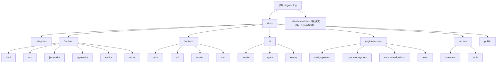

# peigoz-blog 项目 AI 上下文

> 仓库根级 AI 上下文。模块级详情请点击下方模块索引中的链接。

## 项目愿景

**peigoz-blog**（别来无恙）是基于 VitePress 与 `@sugarat/theme` 的个人技术博客，用于沉淀前端、工程、Rust、AI 等领域的学习笔记与面试总结。内容以 Markdown 文章为主体，通过 GitHub Actions 自动构建并部署到 GitHub Pages。

- 站点：<https://peigo.top>
- 源码仓库：<https://github.com/peigoz/peigoz>
- 作者：peigoz（别来无恙）
- 核心价值：低成本维护、目录即结构、纯 Markdown 写作。

## 架构总览

- **站点框架**：VitePress 1.6.3（SSG），根目录 `docs/`。
- **主题**：`@sugarat/theme` 0.5.27 博客主题（含 RSS、pagefind 离线搜索、giscus 评论、mermaid 等能力），在 `docs/.vitepress/theme` 做少量自定义重载。
- **UI 依赖**：Vue 3.4、Element Plus、`xmind-embed-viewer`（XMind 脑图嵌入组件）。
- **包管理**：pnpm（CI 锁定 pnpm 10.34.5），Node 24（volta）。
- **内容组织**：`docs/` 下按 `分类/子分类/文章.md` 三层组织，子目录名经 `dirname-translate.ts` 映射为中文侧边栏标题。
- **动态侧边栏**：`docs/.vitepress/configs/sidebar.ts` 运行时扫描 `docs` 目录生成侧边栏，并将文章顺序写入 `sidebar-cache.ts`。
- **部署**：`.github/workflows/deploy.yml`，push 到 main 即构建并发布 GitHub Pages。

## 模块结构图（Mermaid）



## 模块索引

| 模块 | 路径 | 一句话职责 | 文章/文件数 | 模块文档 |
| ------ | ------ | ----------- | ------------- | ---------- |
| 站点配置与主题 | `docs/.vitepress` | VitePress 主配置、`@sugarat/theme` 主题配置、自定义样式与配色、导航与动态侧边栏生成 | 10 个 TS/MTS + 2 个 SCSS | [.claude/modules/vitepress.md](./.claude/modules/vitepress.md) |
| 前端 | `docs/frontend` | HTML / CSS / JavaScript / TypeScript 基础，框架工程化与零散技巧 | 28 篇文章 | [.claude/modules/frontend.md](./.claude/modules/frontend.md) |
| 后端 | `docs/backend` | Node.js、Rust、数据库与缓存 | 21 篇文章 | [.claude/modules/backend.md](./.claude/modules/backend.md) |
| AI | `docs/ai` | 大模型技巧、Agent 开发、RAG 与随笔 | 7 篇文章 | [.claude/modules/ai.md](./.claude/modules/ai.md) |
| 工程基础 | `docs/engineer-basic` | 设计模式、操作系统、数据结构与算法、代码协同 | 12 篇文章 | [.claude/modules/engineer-basic.md](./.claude/modules/engineer-basic.md) |
| 杂项 | `docs/mixture` | 面试系列与工具软件 | 7 篇文章 | [.claude/modules/mixture.md](./.claude/modules/mixture.md) |
| 静态资源 | `docs/public` | favicon、头像、robots、移动端禁用缩放脚本等（随构建原样拷贝） | 7 个文件 | —（由根级管理） |

> 注：`docs/index.md`（首页）与 `docs/about.md`（关于我）为特殊页面，不归属于任何内容分类模块。
>
> **模块文档一律放在 `.claude/modules/`（仓库根目录下、`docs/` 之外）**，因为 VitePress 会把 `docs/` 下所有 `.md` 编译成可访问页面。不要在 `docs/` 内生成 `CLAUDE.md`。

## 运行与开发

```bash
# 安装依赖（推荐 pnpm，Node >= 24）
pnpm install

# 本地开发（默认 http://localhost:5173）
pnpm dev

# 生产构建（输出到 docs/.vitepress/dist）
pnpm build

# 本地预览构建产物
pnpm serve
```

- `package.json` 脚本：`dev` / `build` / `serve`，均基于 VitePress 的 `docs` 目录。
- 工具链：`typescript`（仅用于配置/脚本类型）、`sass`（SCSS 样式）、`pagefind`（离线搜索索引）、`oxfmt`（格式化）。

## 测试策略

- 本项目为静态博客站点，**无单元/集成测试**。
- 质量保障方式：
  1. `pnpm build` 成功产出 `docs/.vitepress/dist` 视为构建通过（CI 中即以此为准）。
  2. Markdown 语法与 frontmatter 正确性依赖 VitePress 构建期校验。
  3. 侧边栏生成逻辑在构建时由 `sidebar.ts` 自动执行，异常会直接导致构建失败。
- 建议：新增/修改文章后至少本地执行一次 `pnpm build` 验证。

## 编码规范

- **文章 frontmatter**（必需）：`title`（标题）、`date`（`YYYY-MM-DD HH:MM:SS`）、`tags`（数组）、`publish: true`。
  - 可选：`isShowComments`（false 关闭评论）、`hidden`（true 隐藏于列表，如 about.md）。
- **目录规范**：`docs/<分类>/<子分类>/<文章名>.md`，子分类目录名必须出现在 `dirname-translate.ts` 映射表中，否则侧边栏显示英文目录名。
- **写作格式**：VitePress 默认 Markdown 语法；支持 `::: tip` / `::: warning` 等容器、代码块高亮、`fmTitlePlugin`（frontmatter 标题插件）。
- **配置/脚本**：TypeScript 风格，`config.mts` / `configs/*.ts`，ESM 导入；格式化使用 `oxfmt`。
- **忽略清单**：`.gitignore` 含 `node_modules`、`dist`、`cache`、`.temp`、`.obsidian`、`.vscode` 等。注意 `docs/.vitepress/dist` 为构建产物，不应手工编辑。

## 配色体系

主题色在 `docs/.vitepress/theme/user-theme.scss` 顶部用 `:root:root` 覆盖，不直接使用 `@sugarat/theme` 内置的 `el-blue` 原值（`:root:root` 用于压过 `html[theme="el-blue"]` 的 `(0,1,1)` 权重，避免依赖 CSS 打包顺序）。

| 变量 | 浅色 | 深色 | 用途 |
| ------ | ------ | ------ | ------ |
| `--vp-c-brand-1` | `#2b70b3` | `#6aaee6` | 正文链接、导航/侧边栏激活项、主按钮底色 |
| `--vp-c-brand-2` | `#1f5f9c` | `#9ccdff` | hover 态（浅色加深、深色提亮） |
| `--vp-c-brand-3` | `#3d86cc` | `#2b70b3` | 仅作实心按钮底色，配白字 |
| `--vp-c-brand-soft` | `#e8f1fa` | `#182231` | 表头、引用块、选中态底色 |

**约束：**

1. **文字对比度 ≥ 4.5:1（WCAG AA）**。`el-blue` 原值 `#409eff` 在白底仅 2.78:1、`#79bbff` 仅 2.02:1，作为文字不可读——这是覆盖它的根本原因。新增任何文字色都要按 WCAG 相对亮度公式验算。
2. **组件层不要硬编码品牌色**。`.vp-doc` 内的标题与强调色统一写作 `color-mix(in oklab, var(--vp-c-brand-1) X%, <基色>)`，改 `brand-1` 即可整体联动；每项先写纯色兜底、再写 `color-mix`，兼容不支持该函数的浏览器。
3. **`--vp-c-brand-3` 只能当背景色**（配白字 3.83:1），不可作文字色或细图形色。
4. **标题用多色相区分层级**：h1 蓝 → h2 青绿 → h3 紫 → h4 橙 → h5 玫红 → h6 灰。色相固定，仅跟随品牌色微调；混色比例已按 4.5:1 配平，改动后需重新验算。
5. `--doc-link` / `--doc-link-hover` 直接引用 `brand-1` / `brand-2`，深色模式不需要重复定义。

## AI 使用指引

1. **写文章**：在对应分类目录新建 `.md`，补齐 frontmatter（title/date/tags/publish），正文遵循 VitePress Markdown；如需关闭评论加 `isShowComments: false`。
2. **新增子分类**：创建目录 → 添加文章 → 在 `dirname-translate.ts` 注册中文名 → 必要时更新 `nav.ts` 导航。
3. **改主题/样式**：
   - `docs/.vitepress/theme/style.scss`：布局层重载（首页背景图、侧边栏折叠动画等）。
   - `docs/.vitepress/theme/user-theme.scss`：主题色与正文配色重载（已启用，`theme/index.ts` 中引入）。改动前先读文件头的对比度约束，详见下方「配色体系」。
4. **改站点全局配置**：`docs/.vitepress/config.mts`（导航、图标、sitemap、语言等）；`docs/.vitepress/blog-theme.ts`（评论、页脚、主题色、友链等 `@sugarat/theme` 专属项）。
5. **侧边栏顺序调整**：直接编辑 `sidebar-cache.ts` 中对应目录数组，或改动后运行构建让其自动重写（`sidebar.ts` 会重写该文件）。
6. **注意**：`docs/.vitepress/dist` 为构建产物，禁止手工改动；`node_modules` 勿动。
7. **模块文档**：统一写在 `.claude/modules/<模块>.md`，**不要放进 `docs/`**（会被 VitePress 编译成页面）。新增子分类或调整模块边界时同步更新对应文件与上方模块索引。

## 变更记录 (Changelog)

- **2026-10-29（二）**：模块结构同步「目录迁移」后的真实结构（`basic`→`frontend`，`senior` 拆为 `backend`/`ai`/`frontend/senior`）。根文档模块索引、Mermaid 图与统计数字全部重写；6 个模块文档生成到 `.claude/modules/`（位于 `docs/` 之外，避免被 VitePress 编译为可访问页面），修复了原有 5 个模块文档的失效链接。
- **2026-10-29**：重做主题配色。`user-theme.scss` 顶部覆盖 `el-blue` 品牌色阶（`--vp-c-brand-1/2/3/soft`）为可读深蓝；`.vp-doc` 内链接、列表符号、引用边框、行内代码、h6、em、删除线统一修正到 ≥ 4.5:1；新增「配色体系」章节与配色约束。
- **2026-08-27**：首次初始化项目 AI 上下文。生成根级 `CLAUDE.md`、5 个模块级 `CLAUDE.md`（`.vitepress`、`basic`、`engineer-basic`、`senior`、`mixture`）与 `.claude/index.json`；新增模块结构 Mermaid 图与各模块导航面包屑。
